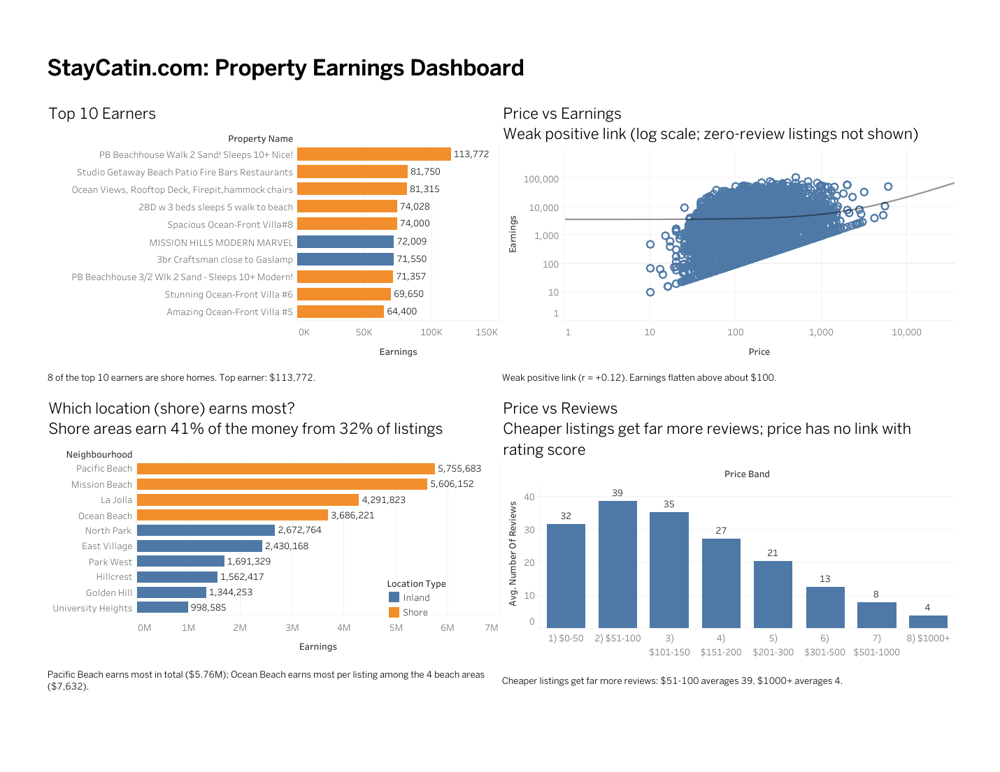

# StayCatin.com: Property Earnings Analysis (Tableau)

An interactive Tableau dashboard and story that helps StayCatin.com management (an Airbnb-style booking platform) understand which listings earn the most and what drives earnings.

**Live dashboard:** [View on Tableau Public](https://public.tableau.com/views/StayCatin_Dashboard_17914047893280/Dashboard1?:language=en-US&:sid=&:redirect=auth&:display_count=n&:origin=viz_share_link)

## Business questions

1. Who are the top 10 earners?
2. What is the relationship between price and earnings?
3. Does any location (shore) earn more?
4. What is the relationship between price and reviews?

## Data

San Diego listings from the StayCatin.com case study dataset (provided as part of a Coding Ninjas project, not included in this repo): 11,922 listings across 112 neighbourhoods.

## Method

- **Earnings** = price per booking x number of reviews. Reviews are mandatory for every booking, so reviews are used as a proxy for the number of bookings.
- **Shore** = Pacific Beach, Mission Beach, Ocean Beach, La Jolla, Del Mar Heights, Sunset Cliffs and Torrey Pines. All other named neighbourhoods are treated as inland. Listings with no neighbourhood (846) are excluded from the location comparison.
- Price and earnings are skewed by a few very expensive listings, so the relationship is shown on a log scale and measured with Spearman rank correlation.

## Key findings

- Total estimated earnings are about **$48.0M** from 344,551 bookings.
- **8 of the top 10 earners are on the shore**, and all 10 are entire homes. The top earner is a Pacific Beach house at $113,772.
- The top 10% of listings earn **53%** of all earnings.
- **Price vs earnings:** weak positive link (Spearman r = +0.12). Median earnings rise up to about $100 and then flatten. The $51-150 price bands hold 48% of listings and bring 44% of earnings.
- **Shore vs inland:** shore areas earn **41% of earnings from 32% of listings**, or $5,270 per listing versus $3,597 inland. Pacific Beach ($5.76M), Mission Beach ($5.61M), La Jolla ($4.29M) and Ocean Beach ($3.69M) lead.
- **Price vs reviews:** weak negative link (r = -0.19). Listings at $51-100 average 39 reviews, while listings above $1,000 average 4. Price has almost no link with the rating score (r = -0.01).

## Recommendations

1. Grow shore supply in Pacific Beach, Ocean Beach, Mission Beach and La Jolla.
2. Guide hosts toward the $100-300 range for entire homes.
3. Support premium listings above $500 with promotions and flexible minimum stays.
4. Activate the 18% of listings that have no reviews.

## Limitations

Earnings are an estimate. They ignore length of stay, discounts and guests who do not leave a review, so values are best read as relative, not exact revenue.

## Files

| File | Description |
|---|---|
| `Dashboard_DevSuthar.pdf` | Final dashboard exported from Tableau Public |
| `Story_DevSuthar.pdf` | 6-point Tableau story with insights and recommendations |
| `StayCatin_Analysis_DevSuthar.xlsx` | Listing-level earnings and summary tables |
| `dashboard_preview.png` | Preview image used in this README |

## Tools

Tableau Public, Excel, Python (pandas) for data checks.

## Author

Dev Suthar
